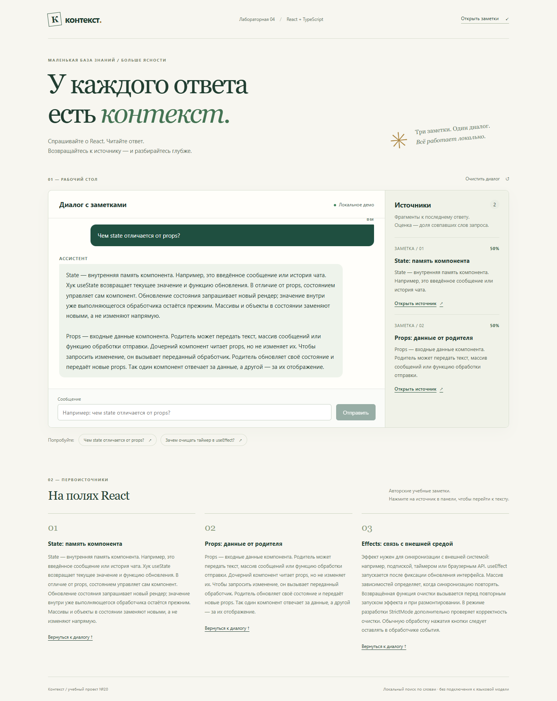
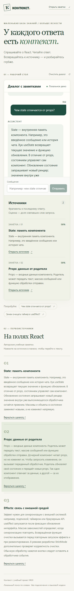

# Лабораторная работа №4 — студент 20

## Контекст
Библиотека UI-компонентов на React и TypeScript и приложение с примером использования. Задание №20: окно чата и панель источников. Сторонних UI-библиотек нет.

- `ui-library` — библиотека `@my-app/ui-library`, сборка ES-модуля, CSS и TypeScript-деклараций.
- `frontend` — приложение на Vite, которое импортирует собранную библиотеку через локальную зависимость.
- `tasks/prd-chat-sources.md`, `prd.json`, `progress.txt` — требования и этапы выполнения.

## Запуск
Проверено на Node.js 24.19.0 и npm 11.17.0. Нужен Node.js, совместимый с Vite 7 (20.19+ или 22.12+). Команды выполнять из папки `lab4-react/solutions/student-20`.

```powershell
cd ui-library
npm ci
npm run build
cd ../frontend
npm ci
npm run dev
```

Открыть адрес из вывода Vite, обычно http://localhost:5173. Для фиксированного адреса:

```powershell
npm run dev -- --host 127.0.0.1 --port 5184 --strictPort
```

Для разработки библиотеки в отдельном терминале выполнить `npm run dev` в `ui-library`: сборка будет обновляться при изменении исходников. Затем запустить `npm run dev` в `frontend`.

После изменения библиотеки перед сборкой приложения повторить `npm run build` в `ui-library`.

## Возможности
- Лента сообщений с ролями пользователя и ассистента, автоматическая прокрутка.
- Отправка кнопкой или Enter, очистка черновика после отправки.
- Пробельный ввод не отправляется. Во время ответа поле, кнопка и готовые вопросы заблокированы.
- Индикатор набора текста во время задержки 700 мс.
- Найденные фрагменты и релевантность в процентах. Ссылки ведут к полным текстам заметок ниже на странице; выбранная заметка подсвечивается.
- Пустое состояние панели, очистка диалога, адаптация под узкий экран.
- Подписи для скринридеров, навигация клавиатурой, видимый фокус, отключение анимации при reduced motion.

## Как устроен ответ
Демо работает локально по трём учебным заметкам: state, props и useEffect. Сервер и ключи API не нужны. Ответ составляется из текстов подходящих заметок.

Поиск переводит запрос в нижний регистр, удаляет пунктуацию, повторяющиеся слова, слова короче трёх символов и служебные слова. Затем сравнивает оставшиеся слова со списком ключевых слов каждой заметки. Релевантность — число совпавших слов / число значимых уникальных слов запроса. Источники сортируются по числу совпадений.

Например, запрос `STATE state props` содержит два уникальных значимых слова: каждая из двух заметок получает 50%. Это оценка совпадения слов, а не вероятность правильности ответа. Запрос без совпадений получает сообщение об отсутствии ответа и пустую панель источников. История хранится только до перезагрузки.

## Интерфейс библиотеки
Импорт компонентов: `@my-app/ui-library`. Стили: `@my-app/ui-library/style.css`.

### ChatWindow
| Prop | Тип | Назначение |
| --- | --- | --- |
| messages | readonly ChatMessage[] | История в порядке отображения |
| onSend | (text: string) => void | Получает текст без пробелов по краям |
| isTyping | boolean, по умолчанию false | Индикатор набора и блокировка ввода |

`ChatMessage`: `id: string`, `role: 'user' или 'assistant'`, `text: string`.

Историей владеет приложение. Компонент хранит только черновик сообщения. Текст отображается как обычный текст, без интерпретации HTML.

### SourcesPanel
`SourcesPanel` получает `sources: readonly SourceFragment[]`. Каждый фрагмент содержит `id`, `title`, `excerpt`, `url` (строки) и `relevance` (число от 0 до 1). URL задаёт вызывающее приложение. В демо это ссылки на заметки внутри страницы. Нативная ссылка доступна мышью и клавиатурой.

## Проверки
В каждом проекте отдельно:

```powershell
npm run lint
npm run build
npm test -- --runInBand
npm run test:coverage -- --runInBand
```

Дополнительно доступна команда `npm run lint:fix`. Отчёт покрытия: `coverage/lcov-report/index.html` внутри соответствующего проекта. Для `SourcesPanel` в Jest закреплён порог 90% по statements, branches, functions и lines.

Результаты: [docs/verification.md](docs/verification.md).

### Ручная проверка
1. Открыть приложение и ввести только пробелы: отправка недоступна.
2. Отправить «Чем state отличается от props?»: появится вопрос, индикатор, затем ответ и два источника по 50%.
3. Нажать «Открыть источник»: URL получит `#document-state` или `#document-props`, страница перейдёт к заметке.
4. Отправить «Как приготовить борщ?»: сообщение об отсутствии ответа, источников нет.
5. Нажать «Очистить диалог»: останется приветствие.
6. Уменьшить окно до 390 px: панель источников расположится под чатом, горизонтальной прокрутки нет.

## Скриншоты
### Ответ и источники


### Узкий экран и переход к заметке

